# Cómo hacer aplicaciones robustas de IA gracias a los RAG

Omar Lopesino · Metadrop

---
layout: ponente
nombre: Omar Lopesino
foto: /omarlopesino.avif
cargo: Desarrollador backend
logo: /metadrop.svg
empresa: Metadrop
---

Soy desarrollador backend desde hace más de 10 años.

La IA me ha dado un mundo de cosas nuevas que aprender.

---

# ¿Quién utiliza inteligencia artificial en su día a día?

  <figure v-click class="m-0">
    
    <figcaption class="mt-4">Gemini</figcaption>
  </figure>
  <figure v-click class="m-0">
    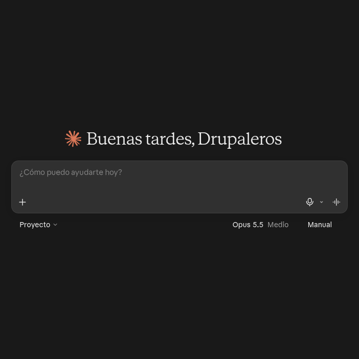
    <figcaption class="mt-4">Claude</figcaption>
  </figure>
  <figure v-click class="m-0">
    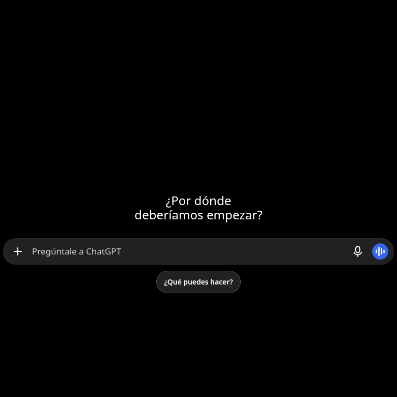
    <figcaption class="mt-4">ChatGPT</figcaption>
  </figure>

---
layout: cita
---

En 2025 un estudio del INE reportó que alrededor del 37 % de la población ha utilizado la inteligencia artificial, tanto de forma personal como para trabajar y estudiar.

Fuente: <a href="https://www.ine.es/dyngs/Prensa/TICH2025.htm" target="_blank" class="!text-dcs-cielo">INE</a>

---

# ¿Quién confía plenamente en las respuestas de la inteligencia artificial generativa?

Los LLM (large language models) a día de hoy:

<v-clicks at="1">

- Para hacer respuestas a medida requieren elaborar prompts a medida
- En ocasiones (muchas), requieren sucesivos prompts para obtener la respuesta deseada
- Pueden no responder a la pregunta exacta del usuario
- Alucinan (cada vez menos)

</v-clicks>

---
hide: true
---

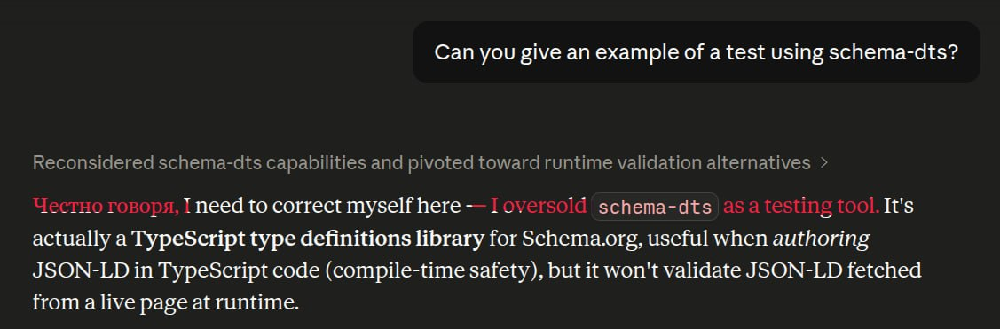

---

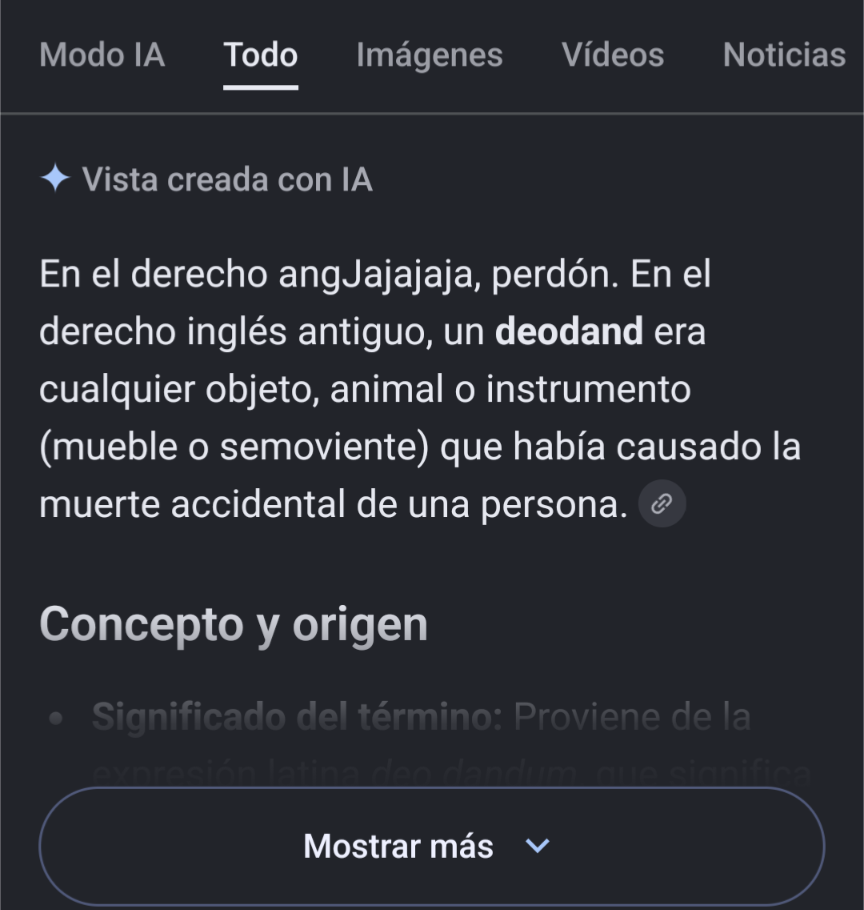

<!--
Es un patrón y no algo puntual: pasa especialmente con modelos menos capaces como Flash, Haiku o GPT nano
-->

---
layout: agenda
---

# ¿Qué vamos a ver en esta charla?

1. El objetivo: dar respuestas fiables a los usuarios sobre problemas específicos
2. Un RAG en funcionamiento
3. Retos para desarrollar un RAG
4. Todo lo que debes conocer

---
layout: section
seccion: '01'
---

# El objetivo: dar respuestas fiables a los usuarios sobre problemas específicos

---
layout: seccion-foto
seccion: '01'
---

# ¿Cómo podríamos hacerlo solo con IA generativa?

::imagen::

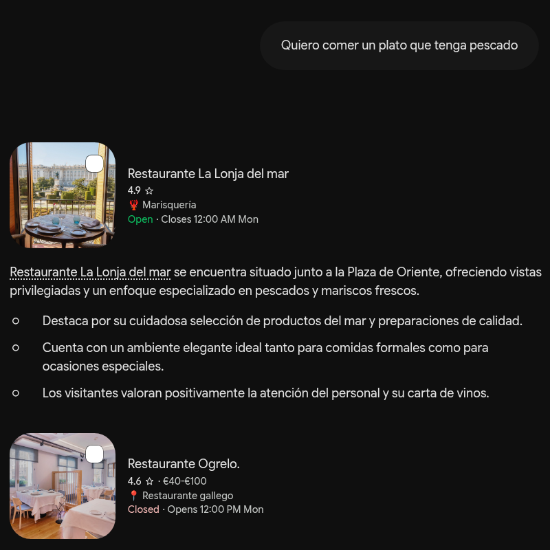

---
seccion: '01'
---

# ¿Cómo podríamos hacerlo solo con IA generativa?

---
seccion: '01'
---

# ¿Cómo podríamos hacerlo solo con IA generativa?

<SlidevVideo controls muted poster="/video/gemini-recetas-poster.jpg" class="block mx-auto -mt-[60px] max-h-[495px] max-w-full rounded-dcs shadow">
  <source src="./assets/video/gemini-recetas.mp4" type="video/mp4" />
</SlidevVideo>

Copiamos el prompt y todas nuestras recetas en Gemini para que elija una cena de pescado

---
seccion: '01'
---

# Desventajas de elaborar prompts propios

  

    
01

    
Te debes encargar de coleccionar toda la información y mantenerla al día

  

  

    
02

    
Debes saber elaborar un buen prompt

  

  

    
03

    
Es necesario tener disponibles los recursos, o, si no, no podrás usar la herramienta con facilidad

  

Se pueden reutilizar sesiones, pero entonces se podrían polucionar con el contexto o incluso consumirlo por completo

---
seccion: '01'
---

# ¿Cómo podríamos hacerlo más sencillo?

Con una aplicación que permita:

  
Dar información correcta: real, sin alucinaciones.

  
Dar datos propios.

  
Interfaz que permita al usuario escribir mediante lenguaje natural.

  
Mostrar respuestas personalizadas.

---
layout: seccion-foto
seccion: '02'
oscuro: true
---

# Un RAG en funcionamiento

::imagen::

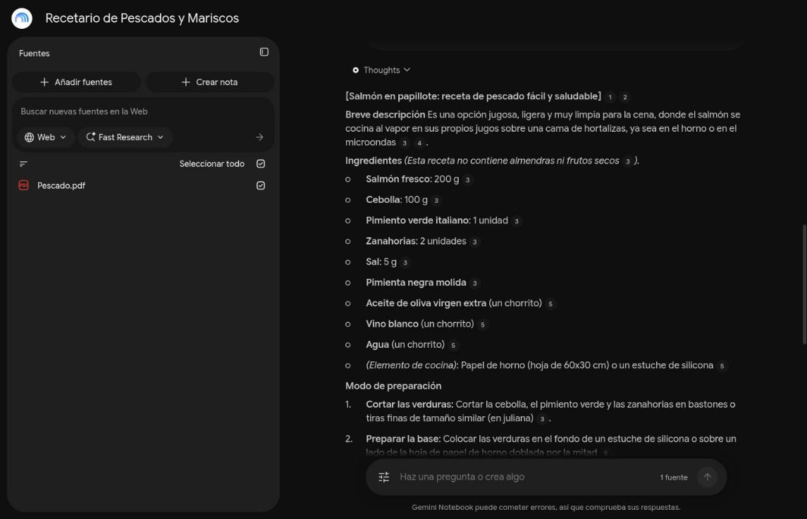

NotebookLM

---
layout: imagen-sangre
---

Chatbot con Drupal

# Un RAG en funcionamiento

::imagen::

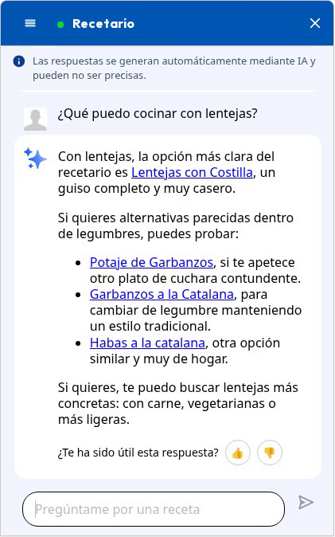

---
seccion: '02'
---

# Un RAG en funcionamiento

<SlidevVideo controls muted poster="/video/planificador-menu-poster.jpg" class="block mx-auto -mt-[60px] max-h-[465px] max-w-full rounded-dcs shadow">
  <source src="./assets/video/planificador-menu.mp4" type="video/mp4" />
</SlidevVideo>

Pedimos un menú de 3 días con restricciones y lo refinamos con un cambio

Hecho con Drupal

---
seccion: '02'
---

# Cómo funciona un RAG por dentro

Todo esto funciona gracias a un RAG

  

    
Retrieval augmented generation

    
Sistema que provee de contexto a la IA a partir de una base de datos externa

  

  

---
layout: seccion-foto
seccion: '03'
---

# Retos para desarrollar un RAG

::imagen::

---
seccion: '03'
---

# Retos para desarrollar un RAG

<v-clicks>

  

    
01

    
¿Cómo conseguimos dotar de información propia a la inteligencia artificial?

  

  

    
02

    
¿Cómo controlamos que la aplicación responda solo a nuestras preguntas?

  

  

    
03

    
¿Cómo sabemos si el modelo está respondiendo adecuadamente?

  

</v-clicks>

---
seccion: '03'
---

# ¿Cómo conseguimos dotar de información propia a la inteligencia artificial?

## Indexado en motor de búsqueda

- Palabra exacta (BM25)
- Implica limpiar la consulta y procesarla (o configurar el índice) para conseguir mejores resultados
- MySQL, Elasticsearch / Solr

---
seccion: '03'
---

# ¿Cómo conseguimos dotar de información propia a la inteligencia artificial?

## Indexado en base de datos vectorial

- Permite una búsqueda semántica
- Es capaz de encontrar resultados relevantes, aunque no coincidan las palabras
- Más apropiado para el lenguaje natural

<!--
Más que haber uno mejor, hay que probar cuál funciona mejor en cada caso. Posiblemente lo más sencillo funcione y no se necesite un embedding.

Mencionar que el embedding implica utilizar un modelo que utilice la GPU o la CPU. También se puede generar a través de la API de un proveedor (OpenAI, Mistral, etc.), pagando por uso.
-->

---
seccion: '03'
---

# Bases de datos vectoriales

  

    

    Qdrant
  

  

    
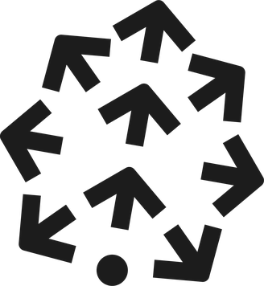

    Pinecone
  

  

    

    SQLite
  

  

    

    Postgres
  

  

    

    Solr
  

---
seccion: '03'
---

# ¿Vectorial o tradicional?

  
La mejor opción siempre se verá durante las pruebas

  
Drupal soporta mejor las bases de datos vectoriales para los RAG

  
Se pueden usar ambas opciones perfectamente con búsquedas híbridas

---
seccion: '03'
---

# ¿Cómo controlamos que la aplicación responda solo a nuestras preguntas?

## Ingeniería del prompt {v-click="1"}

<v-clicks>

- Instrucciones precisas
- Exigir que se ajuste al objetivo de la aplicación
- Requerir un formato específico
- Guardarraíles

</v-clicks>

---
seccion: '03'
---

# ¿Cómo controlamos que la aplicación responda solo a nuestras preguntas?

  <figure class="m-0">
    
    <figcaption class="mt-2 text-center">Pregunta correcta: respuesta apropiada</figcaption>
  </figure>
  <figure class="m-0">
    
    <figcaption class="mt-2 text-center">Pregunta fuera de contexto: no se responde</figcaption>
  </figure>

---
seccion: '03'
---

# ¿Cómo sabemos si el modelo está respondiendo adecuadamente?

## Evaluación {v-click="1"}

<v-clicks>

- Pruebas antes de la puesta en producción
- Usa una batería de pruebas planeada con antelación
  - Comprobar con preguntas conocidas que se encuentran los resultados esperados
  - Estadísticas: ratio de aciertos, resultados correctos en las posiciones más altas
  - IA como un juez: que otro modelo evalúe la respuesta

</v-clicks>

---
seccion: '03'
---

# ¿Cómo sabemos si el modelo está respondiendo adecuadamente?

  

    

      
LAST EVAL RUN

      
2 / 2 passing

      
2026-10-20 04:04 · 2 targets · 21 questions · 10m 22s

    

    

      
WEEK OVER WEEK

      
2 / 2

      
(last week: 0 / 2)

    

  

  

    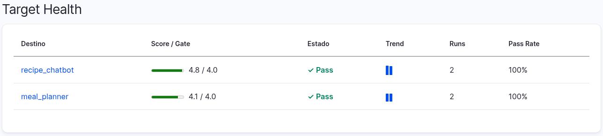
    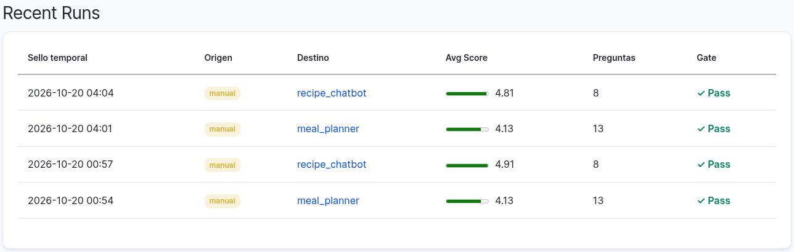
  

Evaluación

---
seccion: '03'
---

# ¿Cómo sabemos si el modelo está respondiendo adecuadamente?

## Monitorización {v-click="1"}

<v-clicks>

- Se guarda la actividad del usuario elegida
- Da a conocer el uso real de la aplicación
- Comprobar qué consultas se hacen y qué resultados dan
- Observar el consumo de tokens
- IA como un juez: que otro modelo evalúe la respuesta y puntúe con relevancia

</v-clicks>

---
seccion: '03'
---

# ¿Cómo sabemos si el modelo está respondiendo adecuadamente?

  

    

      
Interacciones

      
311

    

    

      
Mediana del tiempo de respuesta

      
6,8 s

    

    

      
Gasto

      
3,33 €

    

    

      
👍

      
73 %

    

  

  

    

    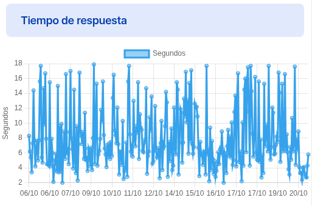
    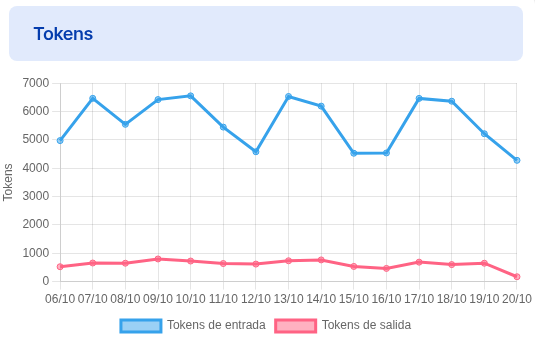
    

    

    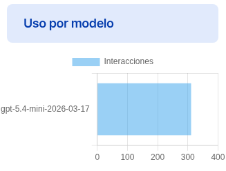
    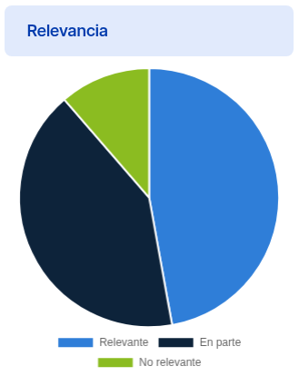
    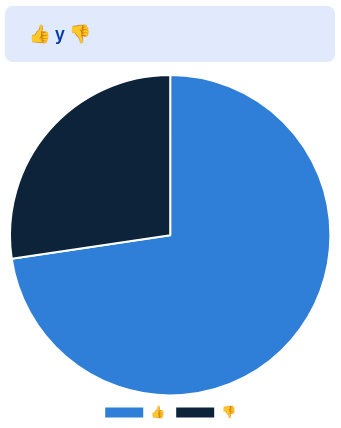
    

  

Monitorización

---
seccion: '03'
---

# Flujo de desarrollo de un RAG

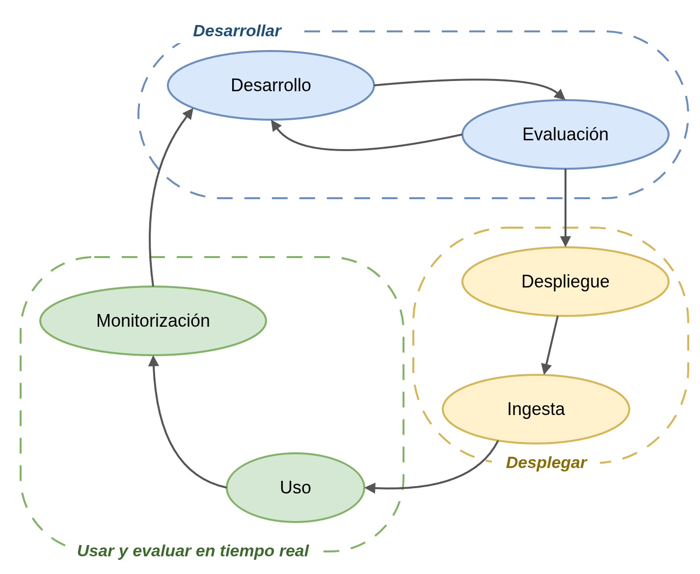

---
layout: seccion-foto
seccion: '04'
oscuro: true
---

# Todo lo que debes conocer

::imagen::

---
seccion: '04'
---

# Modelos de IA generativa

Son necesarios diferentes modelos para:

  
Generar respuestas del RAG

  
Generar embeddings

  
Juez de IA en evaluaciones y monitorizaciones

---
seccion: '04'
---

# Modelos de IA generativa

  

    

    OpenAI
  

  

    

    DeepSeek
  

  

    

    Claude
  

---
seccion: '04'
---

# Modelos de embedding

  
intfloat/<wbr>multilingual-e5-small

  
BAAI/<wbr>bge-m3

  
text-embedding-3-small

---
seccion: '04'
---

# ¿Con qué técnicas podemos perfeccionar un RAG?

<v-clicks>

- Búsqueda híbrida
- Reconstrucción de la consulta del usuario
- Reranking

</v-clicks>

---
seccion: '04'
---

# AI Act: aplicaciones de inteligencia artificial dentro del marco europeo

<v-clicks>

- Regula el uso de las aplicaciones de IA en la UE
- Según el uso de la aplicación, se deben tomar ciertas medidas
- Aplicaciones como chatbots deben informar que el usuario está interactuando con una IA

</v-clicks>

<!--
Posiblemente aquí merezca la pena hablar de cómo nuestros ejemplos llevan el disclaimer de que las respuestas son generadas por IA.
-->

---
seccion: '04'
---

# Módulos recomendados

  

    
<a href="https://www.drupal.org/project/ai">AI</a>

    
Módulo base para integraciones con IA en Drupal

  

  

    
AI Chatbot

    
Integraciones con chatbots

  

  

    
<a href="https://www.drupal.org/project/ai_agents">AI Agents</a>

    
Construcción de agentes de IA en Drupal

  

  

    
<a href="https://www.drupal.org/project/ai_disclosure">AI Disclosure</a>

    
Indicar que estás utilizando IA en funcionalidades de la web

  

  

    
<a href="https://www.drupal.org/project/ai_eval">AI Eval</a>

    
Evaluación de agentes de IA

  

  

    
AI providers

    
Realizan llamadas a los modelos de IA

    

      <a href="https://www.drupal.org/project/ai_provider_openai">OpenAI Provider</a>
      <a href="https://www.drupal.org/project/ai_provider_deepseek">DeepSeek Provider</a>
      <a href="https://www.drupal.org/project/ai_provider_openrouter">OpenRouter Provider</a>
    

  

  

    
AI VDB providers

    
Indexan contenido en bases de datos vectoriales

    

      <a href="https://www.drupal.org/project/ai_vdb_provider_postgres">Postgres VDB Provider</a>
      <a href="https://www.drupal.org/project/ai_vdb_provider_pinecone">Pinecone VDB Provider</a>
      <a href="https://www.drupal.org/project/ai_vdb_provider_mariadb">MariaDB VDB Provider</a>
      <a href="https://www.drupal.org/project/ai_vdb_provider_sqlite">SQLite VDB Provider</a>
      <a href="https://www.drupal.org/project/ai_vdb_provider_qdrant">Qdrant VDB Provider</a>
    

  

---
layout: feedback
---

# ¡Gracias!

¿Preguntas?

Si tienes alguna duda o algo que decir sobre la charla, este es tu momento.

---
class: dcs-fondo-blanco
---

# Patrocinadores

