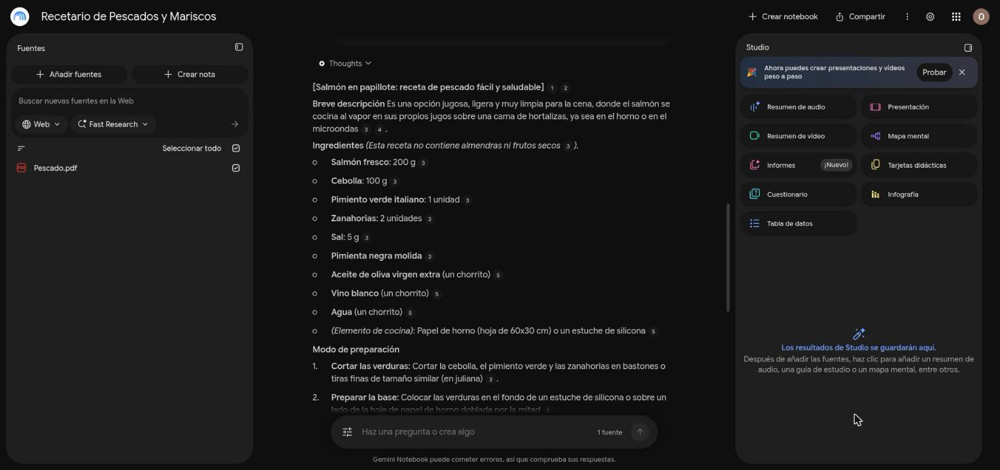
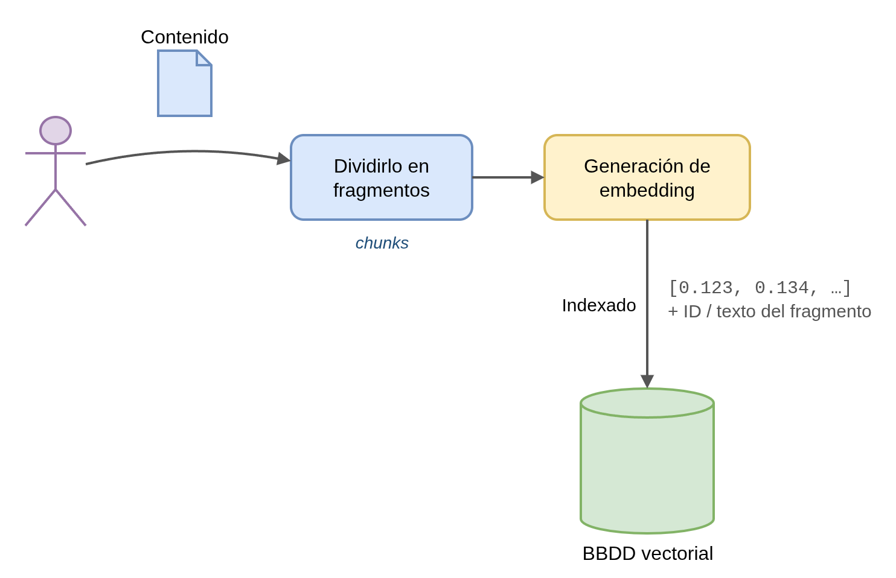

# Cómo hacer aplicaciones robustas de IA gracias a los RAG

---

# Sobre mí

- Omar Lopesino.
- Trabajo en Metadrop.
- Soy desarrollador backend desde hace más de 10 años.
- La IA me ha dado un mundo de cosas nuevas que aprender.

---

# ¿Quién utiliza Inteligencia Artificial en su día a día?

---

# Gemini

---

# Grok

---

# ChatGPT

---
layout: fact
---

En 2025 un estudio del INE reportó que alrededor del 37% de la población ha utilizado la inteligencia artificial, tanto de forma personal como para trabajar y estudiar.

Fuente: <a href="https://www.ine.es/dyngs/Prensa/TICH2025.htm" target="_blank">INE</a>

---

# ¿Quién confía plenamente en las respuestas de la Inteligencia Artificial Generativa?

Los LLM (large language models) a día de hoy:

<v-clicks>

- Alucinan (cada vez menos)
- Pueden no responder a la pregunta exacta del usuario
- En ocasiones (muchas), requieren sucesivos prompts para obtener la respuesta deseada.
- Para hacer respuestas a medida requieren elaborar prompts a medida.

</v-clicks>

---
hide: true
---

# Ejemplo: Programación con IA

En el desarrollo con IA (Claude Code, OpenCode, Pi, Codex) se construyen arneses de seguridad mediante:
- Prompts sofisticados: específicos, claros y sin ruido.
- Reglas que deben seguir los agentes para trabajar: convenciones, metodología, buenas prácticas.
- Conocimiento que le permite entender cómo debe funcionar la aplicación.
- El propio código permite la detección de patrones.

---

# ¿Qué vamos a ver en esta charla?

- El objetivo: Dar respuestas fiables a los usuarios sobre problemas específicos
- El método: Proveer a la IA generativa de un RAG
- Ejemplos
- Cómo funcionan estos sistemas por dentro
- De qué forma podemos desarrollarlo
- Información útil: modelos a utilizar, técnicas, AI Act.

---
hide: true
---

# ¿Cómo podemos llevar este control a las aplicaciones con IA?

<v-clicks>

- Un buen prompt
- Sistema de búsqueda de información: bases de datos tradicionales / bases de datos vectoriales
- Evaluaciones
- Monitorización

</v-clicks>

---

# El objetivo: Dar respuestas fiables a los usuarios sobre problemas específicos

---

# La solución: Aportar valor con la inteligencia artificial

Con una aplicación que permita:

- Dar información correcta: real, sin alucinaciones.
- Dar datos propios.
- Interfaz que permita al usuario escribir mediante lenguaje natural.
- Mostrar respuestas personalizadas.

---

# ¿Cómo podríamos hacerlo solo con IA generativa?

---

# ¿Cómo podríamos hacerlo solo con IA generativa?

---

# ¿Cómo podríamos hacerlo solo con IA generativa?

---

# ¿Cómo podríamos hacerlo solo con IA generativa?

<SlidevVideo controls muted class="mx-auto max-h-90 rounded shadow">
  <source src="./assets/video/gemini-recetas.mp4" type="video/mp4" />
</SlidevVideo>

<!--

Aquí quiero que pongamos un slide con un vídeo donde abra un fichero de Word con recetas, un fichero con un prompt e instrucciones, y todo ello lo pegamos en Gemini, junto con nuestra pregunta inicial para que pueda responder.

Quiero también que después de este slide indiquemos qué problemas presenta esta aproximación.

-->

---

# Desventajas de elaborar prompts propios

- Te debes encargar de coleccionar toda la información y mantenerla al día
- Debes saber elaborar un buen prompt
- Es necesario tener disponibles los recursos, o, si no, no podrás usar la herramienta con facilidad

Se pueden reutilizar sesiones, pero entonces se podrían polucionar con el contexto o incluso consumirlo por completo

---

# ¿Cómo podríamos hacerlo con un RAG?

---

# ¿Cómo podríamos hacerlo con un RAG?

NotebookLM

<!--
Después hará falta mostrar ejemplos de RAGs. Inicialmente, con mostrar un ejemplo de NotebookLM y otro de la documentación de Netlify o un sistema similar nos sirve.

Después podemos poner ejemplos con el RAG que hemos hecho.
-->

---

# ¿Cómo podríamos hacerlo con un RAG?

Chatbot con Drupal

---

# ¿Cómo podríamos hacerlo con un RAG?

<SlidevVideo controls muted class="mx-auto max-h-90 rounded shadow">
  <source src="./assets/video/planificador-menu.mp4" type="video/mp4" />
</SlidevVideo>

Hecho con Drupal

---

# Todo esto funciona gracias a un RAG

- Retrieval augmented generation
- Sistema que provee de contexto a la IA a partir de una base de datos externa

---

# Cómo funciona un RAG por dentro

---

# Retos para desarrollar un RAG

- ¿Cómo conseguimos dotar de información propia a la inteligencia artificial?
- ¿Cómo controlamos que la aplicación responda solo a nuestras preguntas?
- ¿Cómo sabemos si el modelo está respondiendo adecuadamente?

---

# ¿Cómo conseguimos dotar de información propia a la inteligencia artificial?

## Indexado en motor de búsqueda

- Palabra exacta (BM25)
- Implica limpiar la consulta y procesarla (o configurar el índice) para conseguir mejores resultados
- MySQL, Elasticsearch / Solr
- Se puede hacer perfectamente con Search API en Drupal (+ Search API DB, Search API Solr o Search API Elasticsearch)

---

# ¿Cómo conseguimos dotar de información propia a la inteligencia artificial?

## Indexado en base de datos vectorial

- Permite una búsqueda semántica
- Es capaz de encontrar resultados relevantes, aunque no coincidan las palabras
- Más apropiado para el lenguaje natural

<!--
Más que haber uno mejor, hay que probar cuál funciona mejor en cada caso. Posiblemente lo más sencillo funcione y no se necesite un embedding.

Mencionar que el embedding implica utilizar un modelo que utilice la GPU o la CPU. También se puede generar a través de la API de un proveedor (OpenAI, Mistral, etc.), pagando por uso.
-->

---

# ¿Cómo controlamos que la aplicación responda solo a nuestras preguntas?

## Ingeniería del prompt

- Instrucciones precisas
- Exigir que se ajuste al objetivo de la aplicación
- Requerir un formato y longitud específicos
- Más soluciones: añadir guardarraíles

---

# ¿Cómo controlamos que la aplicación responda solo a nuestras preguntas?

Pregunta correcta: Respuesta apropiada

---

# ¿Cómo controlamos que la aplicación responda solo a nuestras preguntas?

Pregunta fuera de contexto: No se responde

---

# Modelos prácticos

<v-clicks>

- ChatGPT 5 (el mini es suficiente)
- DeepSeek
- Claude

</v-clicks>

---

# ¿Con qué técnicas podemos perfeccionar un RAG?

<v-clicks>

- Búsqueda densa o dispersa
- Búsqueda híbrida
- Reconstrucción de la consulta del usuario

</v-clicks>

---

# AI Act: Aplicaciones de inteligencia artificial dentro del marco europeo

<!--
Posiblemente aquí merezca la pena hablar de cómo nuestros ejemplos llevan el disclaimer de que las respuestas son generadas por IA.
-->
