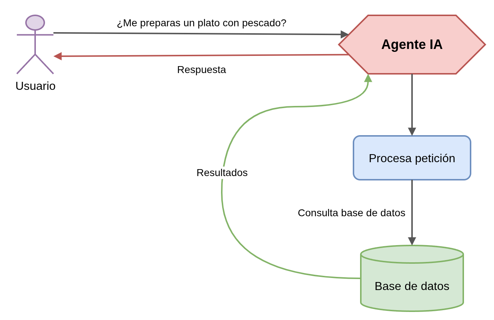
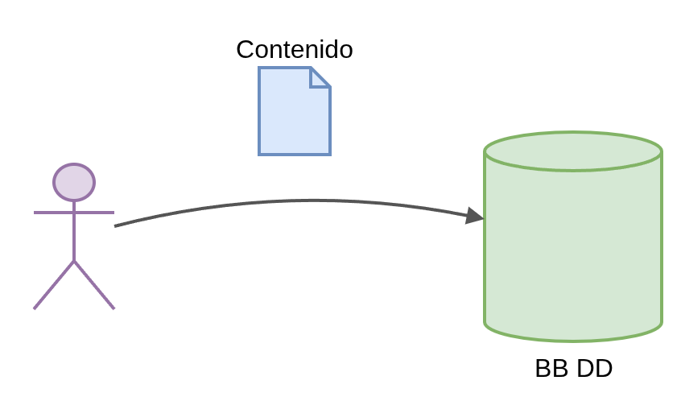
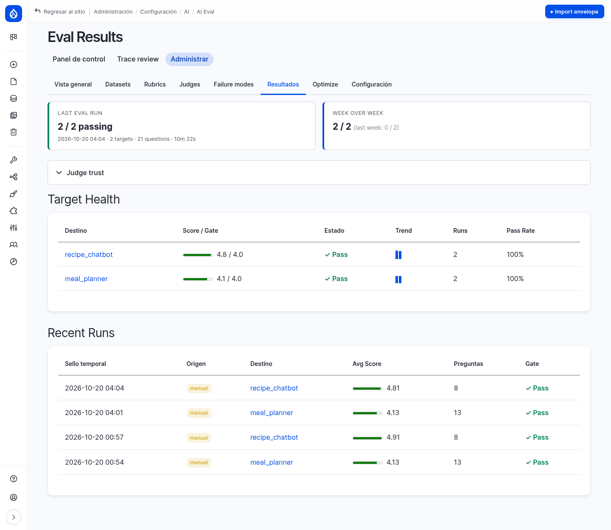
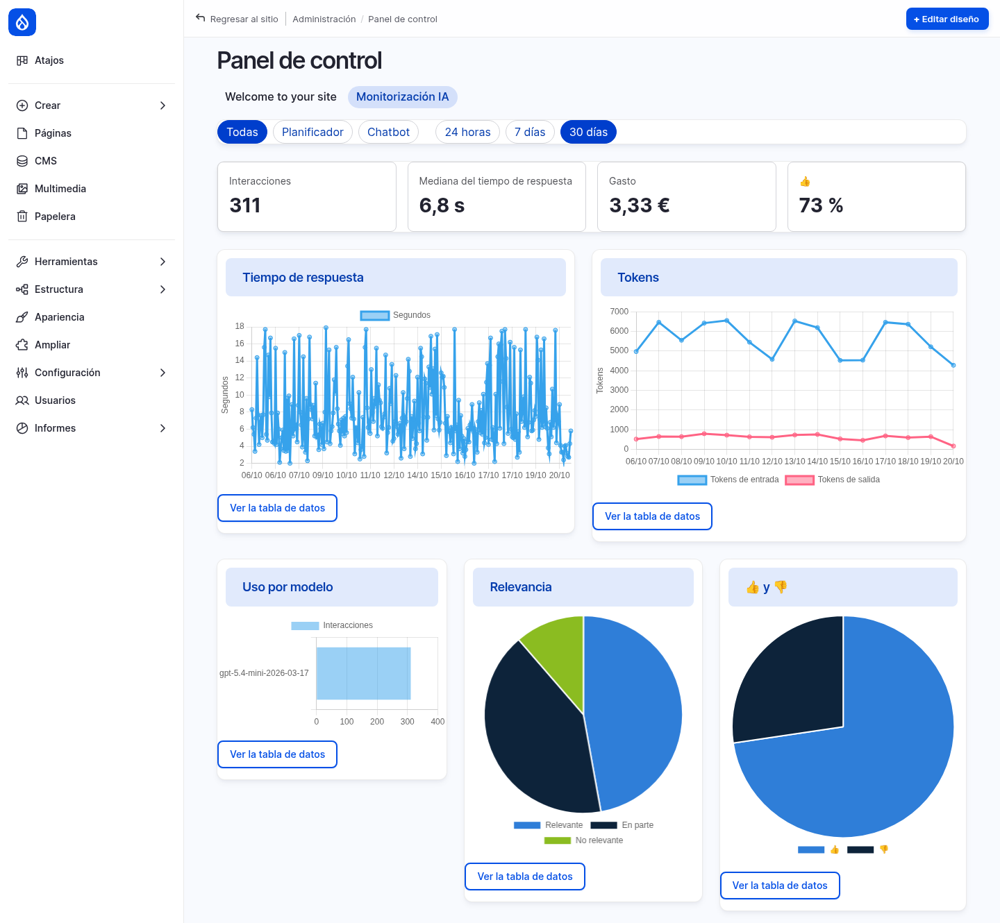

# Cómo hacer aplicaciones robustas de IA gracias a los RAG

---

# Sobre mí

- Omar Lopesino.
- Trabajo en Metadrop.
- Soy desarrollador backend desde hace más de 10 años.
- La IA me ha dado un mundo de cosas nuevas que aprender.

---

# ¿Quién utiliza inteligencia artificial en su día a día?

---

# Gemini

---

# Grok

---

# ChatGPT

---
layout: fact
---

En 2025 un estudio del INE reportó que alrededor del 37 % de la población ha utilizado la inteligencia artificial, tanto de forma personal como para trabajar y estudiar.

Fuente: <a href="https://www.ine.es/dyngs/Prensa/TICH2025.htm" target="_blank">INE</a>

---

# ¿Quién confía plenamente en las respuestas de la inteligencia artificial generativa?

Los LLM (large language models) a día de hoy:

<v-clicks>

- Alucinan (cada vez menos)
- Pueden no responder a la pregunta exacta del usuario
- En ocasiones (muchas), requieren sucesivos prompts para obtener la respuesta deseada.
- Para hacer respuestas a medida requieren elaborar prompts a medida.

</v-clicks>

---

# ¿Qué vamos a ver en esta charla?

- El objetivo: dar respuestas fiables a los usuarios sobre problemas específicos
- El método: proveer a la IA generativa de un RAG
- Ejemplos: solo con IA generativa frente a un RAG
- Cómo funciona un RAG por dentro
- Retos para desarrollar un RAG
- Información útil: modelos a utilizar, técnicas, AI Act.

---

# El objetivo: dar respuestas fiables a los usuarios sobre problemas específicos

---

# El método: proveer a la IA generativa de un RAG

Con una aplicación que permita:

- Dar información correcta: real, sin alucinaciones.
- Dar datos propios.
- Interfaz que permita al usuario escribir mediante lenguaje natural.
- Mostrar respuestas personalizadas.

---

# ¿Cómo podríamos hacerlo solo con IA generativa?

---

# ¿Cómo podríamos hacerlo solo con IA generativa?

---

# ¿Cómo podríamos hacerlo solo con IA generativa?

---

# ¿Cómo podríamos hacerlo solo con IA generativa?

<SlidevVideo controls muted class="mx-auto max-h-90 rounded shadow">
  <source src="./assets/video/gemini-recetas.mp4" type="video/mp4" />
</SlidevVideo>

---

# Desventajas de elaborar prompts propios

- Te debes encargar de coleccionar toda la información y mantenerla al día
- Debes saber elaborar un buen prompt
- Es necesario tener disponibles los recursos, o, si no, no podrás usar la herramienta con facilidad

Se pueden reutilizar sesiones, pero entonces se podrían polucionar con el contexto o incluso consumirlo por completo

---

# ¿Cómo podríamos hacerlo con un RAG?

---

# ¿Cómo podríamos hacerlo con un RAG?

NotebookLM

---

# ¿Cómo podríamos hacerlo con un RAG?

Chatbot con Drupal

---

# ¿Cómo podríamos hacerlo con un RAG?

<SlidevVideo controls muted class="mx-auto max-h-90 rounded shadow">
  <source src="./assets/video/planificador-menu.mp4" type="video/mp4" />
</SlidevVideo>

Hecho con Drupal

---

# Todo esto funciona gracias a un RAG

- Retrieval augmented generation
- Sistema que provee de contexto a la IA a partir de una base de datos externa

---

# Cómo funciona un RAG por dentro

---

# Retos para desarrollar un RAG

- ¿Cómo conseguimos dotar de información propia a la inteligencia artificial?
- ¿Cómo controlamos que la aplicación responda solo a nuestras preguntas?
- ¿Cómo sabemos si el modelo está respondiendo adecuadamente?

---

# ¿Cómo conseguimos dotar de información propia a la inteligencia artificial?

## Indexado en motor de búsqueda

- Palabra exacta (BM25)
- Implica limpiar la consulta y procesarla (o configurar el índice) para conseguir mejores resultados
- MySQL, Elasticsearch / Solr
- Se puede hacer perfectamente con Search API en Drupal (+ Search API DB, Search API Solr o Search API Elasticsearch)

---

# ¿Cómo conseguimos dotar de información propia a la inteligencia artificial?

## Indexado en base de datos vectorial

- Permite una búsqueda semántica
- Es capaz de encontrar resultados relevantes, aunque no coincidan las palabras
- Más apropiado para el lenguaje natural

<!--
Más que haber uno mejor, hay que probar cuál funciona mejor en cada caso. Posiblemente lo más sencillo funcione y no se necesite un embedding.

Mencionar que el embedding implica utilizar un modelo que utilice la GPU o la CPU. También se puede generar a través de la API de un proveedor (OpenAI, Mistral, etc.), pagando por uso.
-->

---

# Bases de datos vectoriales

  Postgres
  Qdrant
  SQLite
  Solr
  Pinecone

---

# ¿Vectorial o tradicional?

- La mejor opción siempre se verá durante las pruebas
- Drupal soporta mejor las bases de datos vectoriales para los RAG
- Se pueden usar ambas opciones perfectamente con búsquedas híbridas

---

# ¿Cómo controlamos que la aplicación responda solo a nuestras preguntas?

## Ingeniería del prompt

- Instrucciones precisas
- Exigir que se ajuste al objetivo de la aplicación
- Requerir un formato y longitud específicos
- Más soluciones: añadir guardarraíles

---

# ¿Cómo controlamos que la aplicación responda solo a nuestras preguntas?

Pregunta correcta: respuesta apropiada

---

# ¿Cómo controlamos que la aplicación responda solo a nuestras preguntas?

Pregunta fuera de contexto: no se responde

---

# ¿Cómo sabemos si el modelo está respondiendo adecuadamente?

---

# ¿Cómo sabemos si el modelo está respondiendo adecuadamente?

## Evaluación

<v-clicks>

- Pruebas antes de la puesta en producción
- Permite testear la búsqueda y el agente antes de su despliegue
- Usa una batería de pruebas planeada con antelación

</v-clicks>

---

# ¿Cómo sabemos si el modelo está respondiendo adecuadamente?

## Evaluación

- Comprobar con preguntas conocidas que se encuentran los resultados esperados
- Estadísticas: ratio de aciertos, resultados correctos en las posiciones más altas
- IA como un juez: que otro modelo evalúe la respuesta

---

# ¿Cómo sabemos si el modelo está respondiendo adecuadamente?

## Evaluación

---

# ¿Cómo sabemos si el modelo está respondiendo adecuadamente?

## Monitorización

<v-clicks>

- Se guarda la actividad del usuario elegida
- Da a conocer el uso real de la aplicación

</v-clicks>

---

# ¿Cómo sabemos si el modelo está respondiendo adecuadamente?

## Monitorización

- Comprobar qué consultas se hacen y qué resultados dan
- Observar el consumo de tokens
- IA como un juez: que otro modelo evalúe la respuesta y puntúe con relevancia

---

# ¿Cómo sabemos si el modelo está respondiendo adecuadamente?

Monitorización

---

# Con esto conseguimos

<v-clicks>

- Medir la calidad de nuestra aplicación
- Saber cuándo mejora o empeora tras modificar prompt o datos
- Evaluar funcionamiento con un uso real

</v-clicks>

---

# Flujo completo

---

# Modelos

Son necesarios diferentes modelos para:

- Generar respuestas del RAG
- Generar embeddings
- Juez de IA en evaluaciones y monitorizaciones

---

# Modelos prácticos

  
OpenAI

  
DeepSeek

  
Claude

  
Qwen

---

# ¿Con qué técnicas podemos perfeccionar un RAG?

<v-clicks>

- Búsqueda densa o dispersa
- Búsqueda híbrida
- Reconstrucción de la consulta del usuario
- Reranking

</v-clicks>

---

# AI Act: aplicaciones de inteligencia artificial dentro del marco europeo

<v-clicks>

- Regula el uso de las aplicaciones de IA en la UE
- Según el uso de la aplicación, se deben tomar ciertas medidas
- Aplicaciones como chatbots deben informar del uso y presencia de la IA

</v-clicks>

Más información: <a href="https://artificialintelligenceact.eu/">https://artificialintelligenceact.eu/</a>

<!--
Posiblemente aquí merezca la pena hablar de cómo nuestros ejemplos llevan el disclaimer de que las respuestas son generadas por IA.
-->

---

# Módulos recomendados

<table class="text-left text-sm !w-auto mx-auto [&_td]:py-1">
  <tr><td><a href="https://www.drupal.org/project/ai">AI</a></td><td>Módulo base para integraciones con IA en Drupal</td></tr>
  <tr><td>AI Chatbot</td><td>Integraciones con chatbots</td></tr>
  <tr><td><a href="https://www.drupal.org/project/ai_agents">AI Agents</a></td><td>Construcción de agentes de IA en Drupal</td></tr>
  <tr><td><a href="https://www.drupal.org/project/ai_disclosure">AI Disclosure</a></td><td>Indicar que estás utilizando IA en funcionalidades de la web</td></tr>
  <tr><td>AI providers</td><td>Realizan llamadas a los modelos de IA</td></tr>
  <tr><td>AI VDB providers</td><td>Indexan contenido en bases de datos vectoriales</td></tr>
</table>
