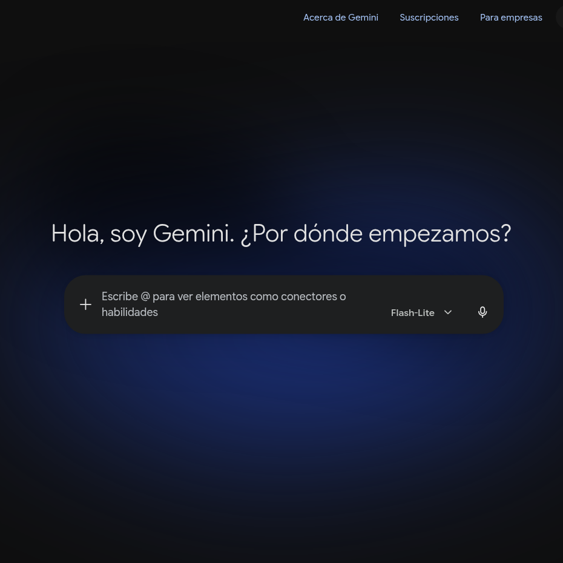
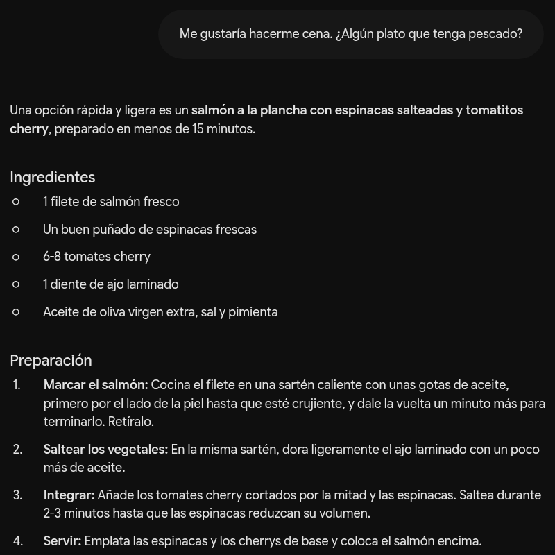

# Cómo hacer aplicaciones robustas de IA gracias a los RAG

---

# Sobre mí

- Omar Lopesino.
- Trabajo en Metadrop.
- Soy desarrollador backend desde hace más de 10 años.
- La IA me ha dado un mundo de cosas nuevas que aprender.

---

# ¿Qué vamos a ver en esta charla?

- El estado actual de la IA y nuestro reto: Crear aplicaciones que usen IA de confianza
- Qué es un RAG
- Ejemplos
- Cómo funcionan estos sistemas por dentro
- De que forma podemos desarrollarlo
- Información útil: modelos a utilizar, técnicas, AI Act.

---

# ¿Quién utiliza Inteligencia Artificial en su día a día?

---

# Gemini

---

# Grok

---

# ChatGPT

---
layout: fact
---

En 2025 se reportó un estudio del INE reporto que alrededor del 37% de la población ha utilizado la inteligencia artificial, tanto de forma personal como para trabajar y estudiar.

Fuente: <a href="https://www.ine.es/dyngs/Prensa/TICH2025.htm" target="_blank">INE</a>

---

# ¿Quién confía plenamente en las respuestas de la Inteligencia Artificial Generativa?

---

---

---

# ¿Podemos tener el control de estas respuestas?

---

# Ejemplo: Programación con IA

En el desarrollo con IA (Claude Code, OpenCode, Pi, Codex) se construyen arneses de seguridad mediante:
- Prompts sofisticados: específicos, claros y sin ruido.
- Reglas que deben seguir los agentes para trabajar: convenciones, metodología, buenas prácticas.
- Conocimiento que le permite entender como debe funcionar la aplicación.
- El propio código permite la detección de patrones.

---

# ¿Como podemos llevar este control a las aplicaciones con IA?

<v-clicks>

- Un buen prompt
- Sistema de búsqueda de información: bases de datos tradicionales / bases de datos vectoriales
- Evaluaciones
- Monitorización

</v-clicks>

